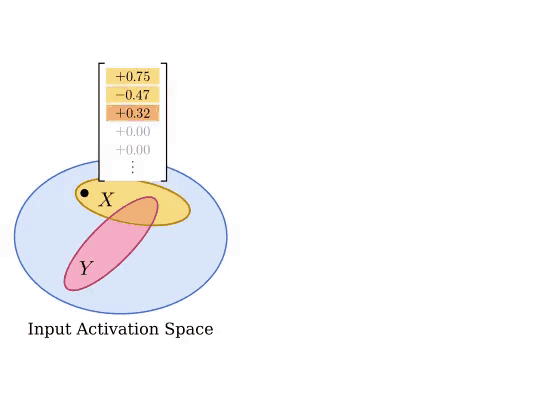

# rspd

**Find the part of a model's weights that one behaviour uses and another does not, in closed form, and take it out.**

<p align="center">
  
</p>

> **Status.** Currently implements the supervised variant (SRSPD). The unsupervised variant is coming soon — end of 2026!

## Install

```bash
pip install rspd
```

`rspd` needs only `torch`. Add `rspd[hf]` to work on Hugging Face models, and `rspd[experiments]` for the data builders, baselines and evaluation used in the experiments.

## Quickstart

```python runnable
from transformers import AutoModelForCausalLM, AutoTokenizer
from rspd import SRSPD

model = AutoModelForCausalLM.from_pretrained("gpt2")
tokenizer = AutoTokenizer.from_pretrained("gpt2")
dutch, english = ["De kat zit op de mat."], ["The cat sits on the mat."]  # your two sets of text

srspd = SRSPD(model, tokenizer)                    # attach
components = srspd.fit(target=dutch, retained=english, mu_per_token=1.0)
components.apply()                                 # W <- W - M in every layer
components.restore()                               # bit-for-bit undo
```

`target` is the behaviour to remove and `retained` is the behaviour to keep; in practice each is a few thousand tokens or more. `fit` does not change the model. It returns one `Component` per weight matrix, with its factors `A` and `B` (`M = A @ B`) and its leaks. `mu_per_token` is the dose: larger removes more.

## How it works

A linear layer only ever acts on the activations it is given. For a set of activations `X`, the layer's response is `W X`, and

```
rank(W X) ≤ min(rank(W), rank(X))
```

So however large `W` is, the part of it that a behaviour uses is no bigger than that behaviour's activations. RSPD reads that part off the activations themselves instead of off the weights. This is the idea behind parameter decomposition, which inspired the technique: a network's weights are a sum of components, each doing one thing.

SRSPD, the supervised variant, takes two sets of activations: a **target** `X` to remove and a **retained** set `Y` to keep. It asks for the component `M` that reproduces the layer on the target and is as quiet as possible on the retained set:

```
M = argmin  ‖W Xᵀ − M Xᵀ‖² + μ ‖M Yᵀ‖²        which has the closed form        M = W XᵀX (XᵀX + μ YᵀY)⁺
```

(Activations are stored one per row, hence the transposes.) There is no training. The solve needs one pass over each set to collect activations and one factorisation per layer input. Subtracting the component, `W ← W − M`, removes the target behaviour and leaves the retained one in place; adding it back restores the model exactly.

Every fit also measures its **leaks** for each matrix: how much of the layer's response to the target survives the subtraction, and how much of its response to the retained set was disturbed. The full derivation is in [`docs/math.md`](docs/math.md).

## Examples

| | | |
| --- | --- | --- |
| [Quickstart on a toy](examples/quickstart.ipynb) | Two overlapping sets and one layer, small enough to see whole. CPU, a few seconds. | [](https://colab.research.google.com/github/ThatE10/rspd/blob/main/examples/quickstart.ipynb) |
| [Erase Dutch from an open language model](examples/erase_dutch.ipynb) | Remove one language from a model and keep the others, on a free Colab GPU. No account needed. | [](https://colab.research.google.com/github/ThatE10/rspd/blob/main/examples/erase_dutch.ipynb) |

The animation at the top is drawn from a real solve on the toy: `python assets/make_demo.py`.

## Documentation

- [`docs/usage.md`](docs/usage.md): install options, supported model families, the command line.
- [`docs/math.md`](docs/math.md): the objective, the closed forms, leaks, the dose, rank truncation.
- [`docs/api.md`](docs/api.md): every public name.
- [`docs/experiments.md`](docs/experiments.md): `rspd[experiments]`.
- [`AGENTS.md`](AGENTS.md): the conventions and the full workflow, written for coding agents.

## Citation

If you use `rspd`, please cite it. [`CITATION.cff`](CITATION.cff) has the machine-readable form.

```bibtex
@software{rspd,
  title = {rspd: Representation-Space Parameter Decomposition},
  url   = {https://github.com/ThatE10/rspd},
  year  = {2026}
}
```

Rank truncation uses the context-aware projector of COALA: Parkina and Rakhuba, *COALA: Numerically Stable and Efficient Framework for Context-Aware Low-Rank Approximation*, arXiv:2507.07580 (NeurIPS 2025).
